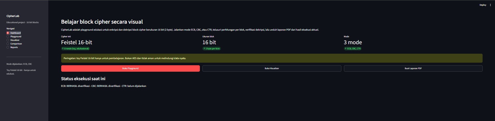
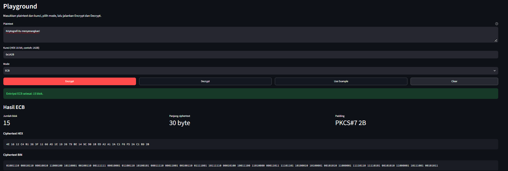
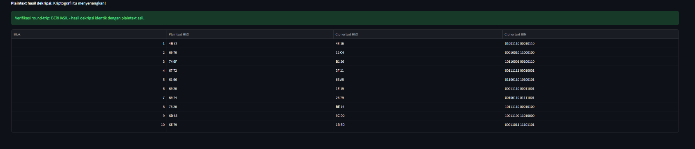
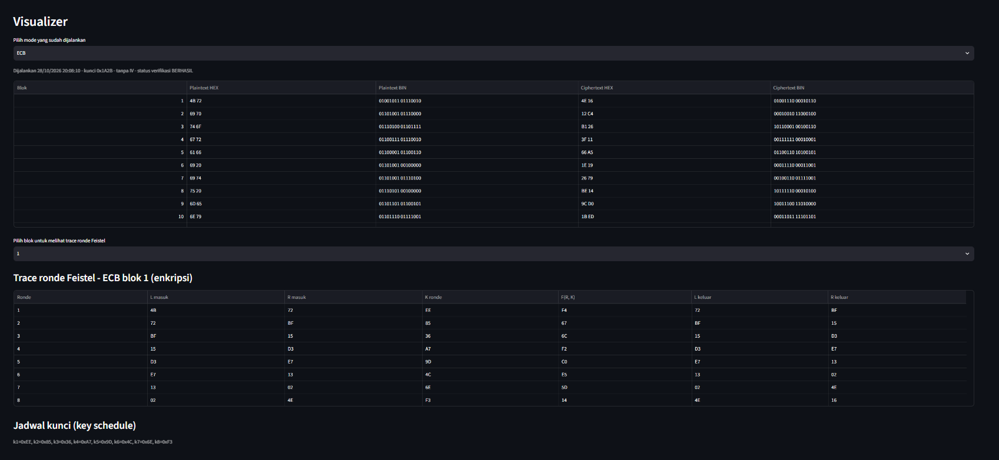
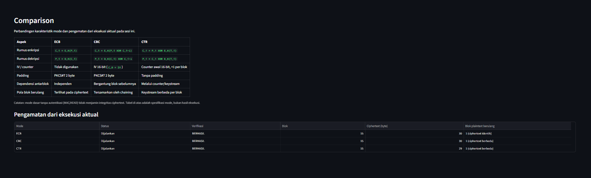
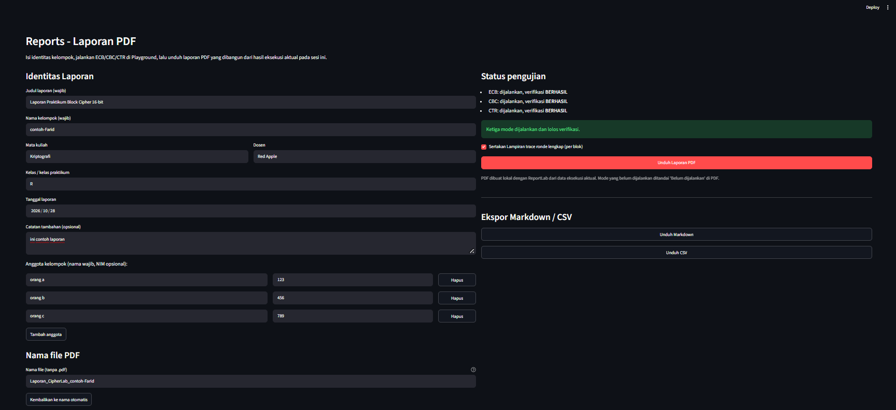

# CipherLab — 16-bit Block Cipher Laboratory

<div align="center">

[](https://www.python.org/)
[](https://streamlit.io/)
[](https://www.reportlab.com/)
[](https://docs.pytest.org/)
[](LICENSE)

*An educational web application & laboratory for exploring block cipher operations using a custom 16-bit Feistel network.*

</div>

---

## 📌 Overview

**CipherLab** is an educational tool designed for cryptography coursework. It provides an interactive web interface to explore, execute, and visualize classic block cipher modes (**ECB**, **CBC**, and **CTR**) built on top of a custom 16-bit Feistel network.

> ⚠️ **Important Security Disclaimer:** This is an educational cipher with 16-bit blocks and keys. It is **not** AES and **must not** be used to protect real-world sensitive data.

---

## ✨ Features

- **🔐 3 Operating Modes**:
  - **ECB Mode**: Electronic Codebook — independent block encryption with PKCS#7 padding.
  - **CBC Mode**: Cipher Block Chaining — chaining blocks with IV and PKCS#7 padding.
  - **CTR Mode**: Counter Mode — stream-like operation preserving plaintext length without padding.
- **👁️ Interactive Visualizer**: Per-block HEX/BIN inspection and step-by-step Feistel round traces ($k_1$ through $k_8$).
- **⚖️ Side-by-Side Comparison**: Direct analysis of formulas, IV/counter, padding, and block dependencies.
- **📄 Professional PDF Reports**: Generate and download complete execution reports using ReportLab directly from app session state.
- **👥 Dynamic Group Management**: Add or remove group members with required names and optional NIMs.
- **🏷️ Customizable Output Filename**: Auto-generated PDF filenames that can be edited before download.
- **📊 Real-time Status Tracking**: Automatic status badges (`BERHASIL`, `GAGAL`, `Belum dijalankan`) per mode.

---

## 📂 Project Structure

```text
CipherLab/
├── app.py                          # Main Streamlit web application
├── requirements.txt                # Python dependencies
├── README.md                       # Project documentation
├── pytest.ini                      # Pytest configuration
├── crypto/                         # Core cryptography engine
│   ├── __init__.py
│   ├── feistel16.py                # 16-bit Feistel cipher core & key schedule
│   ├── padding.py                  # PKCS#7 padding for 2-byte blocks
│   ├── encoding.py                 # Text/bytes conversion, HEX/BIN formatting
│   ├── ecb.py                      # ECB mode implementation
│   ├── cbc.py                      # CBC mode implementation
│   ├── ctr.py                      # CTR mode implementation
│   ├── pipeline.py                 # Execution pipeline (encrypt + verify)
│   └── results.py                  # Result data structures
├── reports/                        # PDF generator and exporters
│   ├── __init__.py
│   ├── pdf_report.py               # ReportLab PDF generator
│   └── export.py                   # Markdown / CSV export utilities
├── tests/                          # Comprehensive automated test suite
│   ├── test_feistel16.py           # Feistel KAT & round tests
│   ├── test_ecb.py                 # ECB mode tests
│   ├── test_cbc.py                 # CBC mode tests
│   ├── test_ctr.py                 # CTR mode tests
│   ├── test_padding.py             # Padding behavior tests
│   ├── test_encoding.py            # Encoding utility tests
│   ├── test_pipeline.py            # Pipeline verification tests
│   ├── test_export.py              # Export tests
│   └── test_pdf_report.py          # PDF generation tests
└── docs/                           # Documentation and assets
    ├── DESIGN-REFERENCE.md
    ├── REPORT-GUIDE.md
    ├── contoh-laporan.pdf          # Sample generated PDF report
    └── screenshots/                # Application screenshots
        ├── dashboard.png
        ├── playground.png
        ├── playground-lanjutan.png
        ├── visualizer.png
        ├── comparison.png
        └── reports.png
```

---

## 🚀 Getting Started

### Prerequisites

- Python 3.10 or higher
- `pip` package manager

### Installation

```powershell
# 1. Clone the repository
git clone https://github.com/zann06/Enskripsi-Block-Cipher.git
cd Enskripsi-Block-Cipher

# 2. Create and activate a virtual environment
python -m venv .venv
.venv\Scripts\Activate.ps1

# 3. Install dependencies
pip install -r requirements.txt
```

### Running the Application

```powershell
streamlit run app.py
```

Open the local URL displayed in your terminal (typically `http://localhost:8501`) in your web browser.

### Running Tests

```powershell
python -m pytest -v
```

---

## 🖥️ Application Screenshots

Here is a preview of the CipherLab user interface across its main pages:

### 1. Dashboard Page
Overview of the 16-bit Feistel cipher, quick navigation cards, and live mode execution status checklist.
<div align="center">
  
</div>

### 2. Playground Page (Input & Execution)
Plaintext input, 16-bit HEX key configuration, mode selection (ECB, CBC, CTR), and cryptographic results.
<div align="center">
  
</div>

### 3. Playground Lanjutan (Advanced Config & Decryption)
Advanced parameters such as IV and Initial Counter configuration alongside decryption verification status.
<div align="center">
  
</div>

### 4. Visualizer Page
Per-block inspection showing HEX/BIN transformations, XOR steps, and complete Feistel round traces ($k_1 - k_8$).
<div align="center">
  
</div>

### 5. Comparison Page
Side-by-side analytical comparison table detailing formulas, padding, IV usage, and block dependency behaviors.
<div align="center">
  
</div>

### 6. Reports Page
Group member management, custom PDF filename editing, and one-click PDF report generation.
<div align="center">
  
</div>

---

## 📑 Sample PDF Report

You can inspect a pre-generated sample PDF report created directly from actual application execution:

- **[📄 Unduh / Lihat Contoh Laporan PDF (docs/contoh-laporan.pdf)](docs/contoh-laporan.pdf)**

---

## 📋 Operating Modes Comparison

| Aspect | ECB (Electronic Codebook) | CBC (Cipher Block Chaining) | CTR (Counter Mode) |
| :--- | :--- | :--- | :--- |
| **Encryption Formula** | $C_i = E_K(P_i)$ | $C_i = E_K(P_i \oplus C_{i-1})$ | $C_i = P_i \oplus E_K(T_i)$ |
| **Decryption Formula** | $P_i = D_K(C_i)$ | $P_i = D_K(C_i) \oplus C_{i-1}$ | $P_i = C_i \oplus E_K(T_i)$ |
| **IV / Counter** | Not required | 16-bit IV ($C_0 = \text{IV}$) | 16-bit Counter (increment +1) |
| **Padding** | PKCS#7 (2-byte blocks) | PKCS#7 (2-byte blocks) | None (Preserves length) |
| **Block Dependency** | Independent blocks | Chained with previous ciphertext | Keystream via counter |
| **Pattern Leakage** | Visible in repeated blocks | Masked by chaining | Masked by keystream |

---

## 🛠️ Technology Stack

- **Python**: Core cryptographic engine and pipeline logic.
- **Streamlit**: Interactive, dark-themed responsive web UI.
- **ReportLab**: Professional programmatic PDF generation.
- **Pytest**: Rigorous automated test suite covering KATs and edge cases.

---

## 📜 License

This project is open-source and available under the [MIT License](LICENSE).
